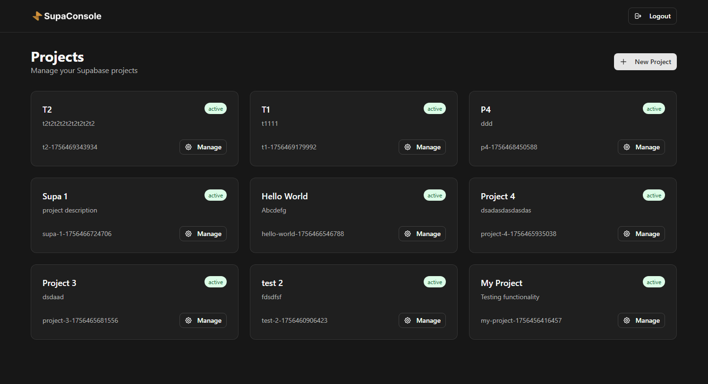

> **Work in progress:** this project is becoming a **preview-environments platform for self-hosted Supabase** — one API call provisions a throwaway Supabase stack from your project's `supabase/` folder (migrations, seed data, edge functions), reachable over HTTPS. The README below is from upstream and no longer fully describes the project.

<div align="center">
 [](https://ascii.rest/banner/)
  <br />
  <br />
  A modern, self-hosted dashboard for managing multiple Supabase projects with Docker. Built with Next.js, TypeScript, and Tailwind CSS.
  <br />
  <br />
  
  
  
  *SupaConsole Dashboard - Manage multiple Supabase projects with ease*
</div>

## ✨ Features

- **🎯 Project Management**: Create, configure, and manage multiple Supabase instances
- **🐳 Docker Integration**: Automated Docker Compose deployment for each project  
- **⚙️ Environment Configuration**: Web-based interface for configuring project environment variables
- **🔗 Service URLs**: Quick access to all running services (Studio, API, Analytics, Database)
- **🗑️ Safe Project Deletion**: Complete cleanup with Docker container removal and file system cleanup
- **👥 Team Management**: User authentication and team member management
- **📧 Email Integration**: Password reset and team invitation emails via SMTP
- **🎨 Modern UI**: Dark theme with responsive design using shadcn/ui components
- **🔒 Secure Authentication**: Built-in user authentication with session management
- **📊 Project Status Tracking**: Monitor project status (active, paused, stopped)
- **⚡ Unique Port Management**: Automatic port allocation to prevent conflicts between projects

## 🛠️ Tech Stack

- **Frontend**: Next.js 15, TypeScript, Tailwind CSS, shadcn/ui
- **Backend**: Next.js API Routes, Prisma ORM
- **Database**: SQLite (easily configurable for PostgreSQL)
- **Authentication**: Custom JWT-based authentication
- **Email**: Nodemailer with SMTP support
- **Containerization**: Docker & Docker Compose
- **Styling**: Dark theme with custom color palette

## 🚀 Quick Start

### Prerequisites

- Node.js 20.3+
- Docker and Docker Compose
- Git
- SMTP email service (Gmail, SendGrid, etc.)

### Installation

1. **Clone the repository**
   ```bash
   git clone https://github.com/your-username/supaconsole.git
   cd supaconsole
   ```

2. **Install dependencies**
   ```bash
   npm install
   ```

3. **Set up environment variables**
   ```bash
   cp .env.example .env
   ```
   
   Edit `.env` with your configuration:
   ```env
   # Database
   DATABASE_URL="file:./dev.db"
   
   # Authentication
   NEXTAUTH_SECRET="your-secret-key-here"
   NEXTAUTH_URL="http://localhost:3000"
   
   # SMTP Configuration
   SMTP_HOST="smtp.gmail.com"
   SMTP_PORT=587
   SMTP_SECURE=false
   SMTP_USER="your-email@gmail.com"
   SMTP_PASS="your-app-password"
   
   # Supabase Core Repository
   SUPABASE_CORE_REPO_URL="git clone --depth 1 https://github.com/supabase/supabase"
   SUPABASE_CORE_REF="self-hosted/v0.8.2"
   
   # Application
   APP_NAME="SupaConsole Dashboard"
   APP_URL="http://localhost:3000"
   ```

4. **Set up the database**
   ```bash
   npm run db:generate
   npm run db:migrate
   ```

5. **Start the development server**
   ```bash
   npm run dev
   ```

6. **Open your browser**
   Navigate to [http://localhost:3000](http://localhost:3000)

## 📖 Usage

### First Time Setup

1. **Register an account** at `/auth/register`
2. **Initialize the workspace** by clicking the "Initialize" button on the dashboard
3. This will:
   - Create a `supabase-core` directory with the Supabase repository
   - Create a `supabase-projects` directory for your projects

### Creating a Project

1. Click **"New Project"** on the dashboard
2. Enter your project name and description
3. Configure environment variables through the web interface
4. The system will:
   - Create a unique project directory
   - Copy Docker files from `supabase-core`
   - Generate environment configuration
   - Run `docker compose pull` and `docker compose up -d`

### Managing Projects

- **View Projects**: All projects are displayed on the main dashboard with status indicators
- **Project Management Modal**: Click "Manage" on any project to access:
  - **Service URLs**: Direct links to Supabase Studio, API Gateway, Analytics, and Database
  - **Configure**: Quick access to environment variable configuration
  - **Safe Deletion**: Complete project removal with confirmation and cleanup
- **Environment Variables**: Update configuration through the web interface
- **Docker Operations**: Automatic container management with unique naming and ports
- **Real-time Status**: Monitor project status (active, paused, stopped)

## ⚠️ Resource Usage Notice

Each project runs in its own Docker container. As more projects are created, additional containers are started, which will consume CPU and memory resources accordingly.

For optimal performance, ensure your server has sufficient resources to support the number of projects you plan to run.

## 🏗️ Project Structure

```
supaconsole/
├── src/
│   ├── app/                    # Next.js App Router
│   │   ├── api/               # API routes
│   │   ├── auth/              # Authentication pages
│   │   └── dashboard/         # Dashboard pages
│   ├── components/            # React components
│   ├── lib/                   # Utility functions
│   │   ├── auth.ts           # Authentication utilities
│   │   ├── db.ts             # Database connection
│   │   ├── email.ts          # Email services
│   │   └── project.ts        # Project management
│   └── generated/            # Prisma client
├── prisma/                   # Database schema
├── public/                   # Static assets
└── supabase-core/           # Cloned Supabase repository (created on init)
└── supabase-projects/       # Individual project directories (created on init)
```

## 🔧 Development

### Available Scripts

```bash
# Development
npm run dev              # Start development server with Turbopack
npm run build           # Build for production
npm run start           # Start production server

# Database
npm run db:generate     # Generate Prisma client
npm run db:migrate      # Apply tracked migrations (baselines legacy db-push DBs)
npm run db:push         # Push schema changes to database (dev shortcut)
npm run db:studio       # Open Prisma Studio
npm run db:reset        # Reset database (⚠️ destructive)

# Code Quality
npm run lint            # Run ESLint
npm run type-check      # TypeScript type checking
npm test                # Run unit tests (Vitest)
```

### Environment Variables

| Variable | Description | Example |
|----------|-------------|---------|
| `DATABASE_URL` | Database connection string | `file:./dev.db` |
| `NEXTAUTH_SECRET` | JWT secret key | `your-secret-key` |
| `SMTP_HOST` | SMTP server hostname | `smtp.gmail.com` |
| `SMTP_USER` | SMTP username | `your-email@gmail.com` |
| `SMTP_PASS` | SMTP password/app password | `your-app-password` |
| `SUPABASE_CORE_REPO_URL` | Supabase repo URL | `https://github.com/supabase/supabase` |
| `SUPABASE_CORE_REF` | Supabase release to pin (tag, branch or full 40-character commit SHA; short SHAs are rejected) | `self-hosted/v0.8.2` |
| `ALLOW_REGISTRATION` | Enable open registration. When unset/false, only the first user can register (bootstrap mode). Set to 'true' for open registration. | `true` |

## 🐳 Docker Integration

The application manages Docker containers for each Supabase project:

1. **Initialization**: Clones Supabase repository to `supabase-core/`
2. **Project Creation**: Copies `docker/` folder to project directory
3. **Environment Setup**: Creates `.env` files from web interface
4. **Container Management**: Runs `docker compose` commands automatically

## 📧 Email Configuration

### Gmail Setup
1. Enable 2-factor authentication
2. Generate an App Password
3. Use the App Password in `SMTP_PASS`

### Other Providers
- **SendGrid**: Use API key as password
- **AWS SES**: Use SMTP credentials
- **Custom SMTP**: Any SMTP-compatible service

## 🚀 Deployment

### Production Build

```bash
npm run build
npm run start
```

### Docker Deployment

Use the included Dockerfile for production. Ensure persistence and Docker socket access:

```bash
# Build image
docker build -t supaconsole .

# Run with persistent SQLite and Docker socket (for Supabase project management)
docker run -d \
  -p 3000:3000 \
  -e DATABASE_URL="file:/app/data/db.sqlite" \
  -e NEXTAUTH_SECRET="$(openssl rand -base64 32)" \
  -v "$PWD/data:/app/data" \
  -v /var/run/docker.sock:/var/run/docker.sock \
  --name supaconsole \
  supaconsole
```

Optional additional volumes:

- `/app/supabase-core` – cached Supabase repo clone
- `/app/supabase-projects` – per-project Docker files

## Preview API

Run one long-lived Next.js Node server per control-plane database. The worker uses
an in-process serial queue; server startup marks interrupted preview operations
failed. Keep failed stacks for inspection, then call destroy before ensuring that
identity again.

Set `PREVIEW_DOMAIN` and `SUPACONSOLE_PREVIEW_BASELINE_VERSION` (a trusted 14-digit
baseline migration boundary for the pinned `self-hosted/v0.8.2` template). For
`fixtures/preview-sample`, the boundary is `20261008000400`. Optional
`SUPACONSOLE_PREVIEW_CORE_DOCKER_DIR` and `SUPACONSOLE_PREVIEW_PROJECTS_ROOT` select
template and project directories. The defaults are `supabase-core/docker` and
`supabase-projects`. The preview worker and its loopback gateway probes run on the
Docker host.

Every endpoint requires a repository-scoped preview token in
`Authorization: Bearer <token>`.

| Endpoint | Input | Response |
| --- | --- | --- |
| `POST /api/previews/ensure` | Query `repository`, `branch`; optional query `pullRequestNumber`, `prTitle`, `prAuthor`; multipart file `tarball` | HTTP 202 with `operationId` and `state` |
| `GET /api/previews/status` | Query parameters `repository`, `operationId` | `operationId`, `state`, `error`; ready operations also include `url`, `anonKey` |
| `POST /api/previews/destroy` | Query `repository`; JSON `operationId` (body limit 4 KiB) | `destroyed: true`; repeated destroy succeeds |

Ensure normalizes repository/branch identity and returns the same operation for
repeated calls, including failed operations. Authorization runs against the query repository before reading
any request body. Tarballs are limited to 64 MiB and multipart bodies to 65 MiB.
The worker validates the tarball,
creates a trimmed stack with fresh credentials, imports SQL with the database
attached only to an internal Docker network, and runs the health gate before
marking ready. Destroy joins any local queued work, removes Docker resources and
the directory, then releases the database row and allocated port.

The public URL is `https://<project-slug>.<PREVIEW_DOMAIN>`. The gateway publishes
on host loopback; public DNS and proxy/tunnel routing are configured separately.
Ready means the local stack passed its health gate. SQL seed files replay through
the importer; the current bundle format does not contain a seed-user manifest.
Preview projects belong to a reserved service account that cannot log in and does
not consume the first-user registration slot.

To run Docker acceptance with an isolated SQLite database and the pinned template:

```bash
DATABASE_URL=file:/tmp/t15-acceptance.db \
SUPACONSOLE_PREVIEW_CORE_DOCKER_DIR=/path/to/supabase-core/docker \
T15_DOCKER_TEST=1 T15_CYCLES=20 \
npx vitest run tests/previews-docker.test.ts --hookTimeout=60000
```

## 🤝 Contributing

We welcome contributions! Please follow these steps:

1. Fork the repository
2. Create a feature branch: `git checkout -b feature/amazing-feature`
3. Make your changes
4. Commit changes: `git commit -m 'Add amazing feature'`
5. Push to branch: `git push origin feature/amazing-feature`
6. Open a Pull Request

## 📝 License

This project is licensed under the MIT License - see the LICENSE file for details.

---

<div align="center">
  <strong>Built with ❤️ for the Supabase community</strong>
</div>
